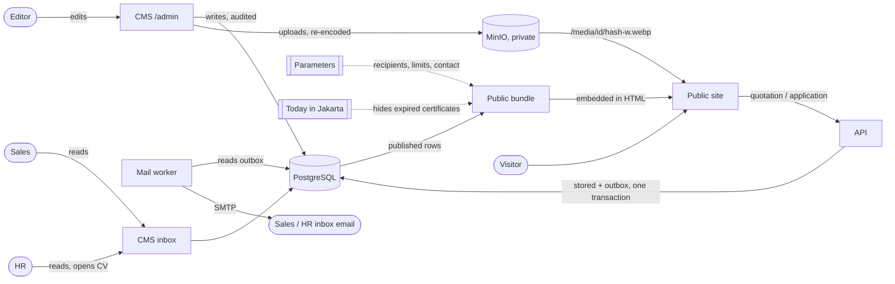
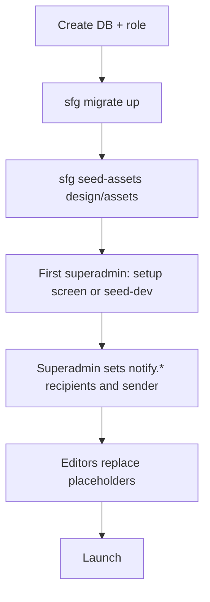
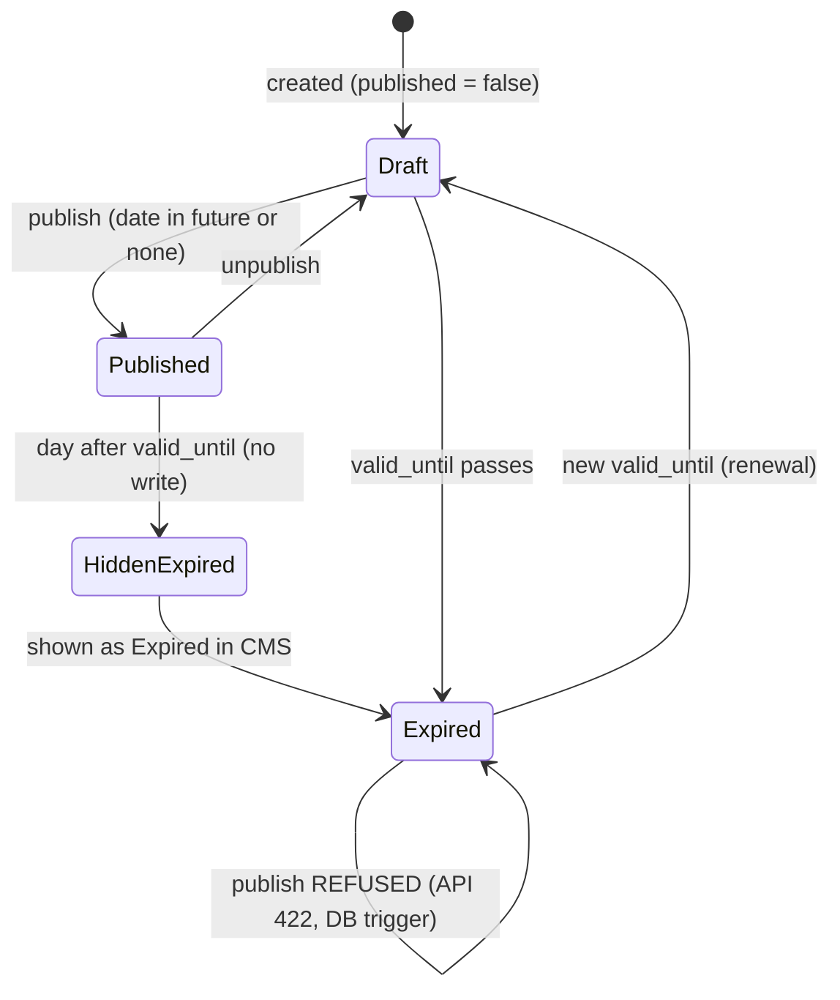
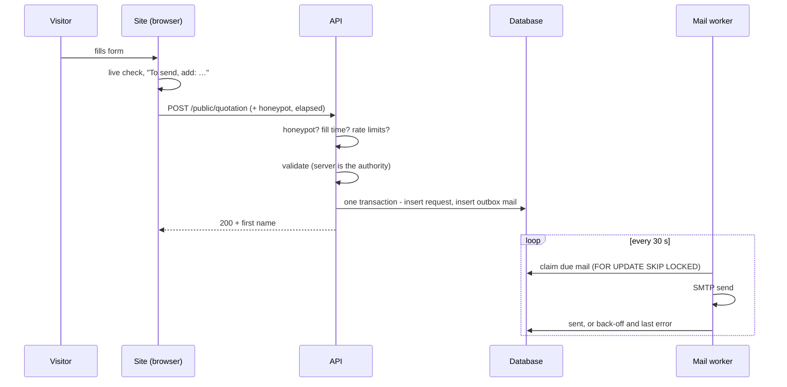
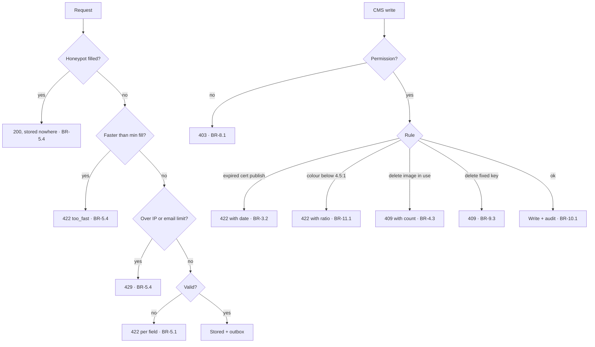
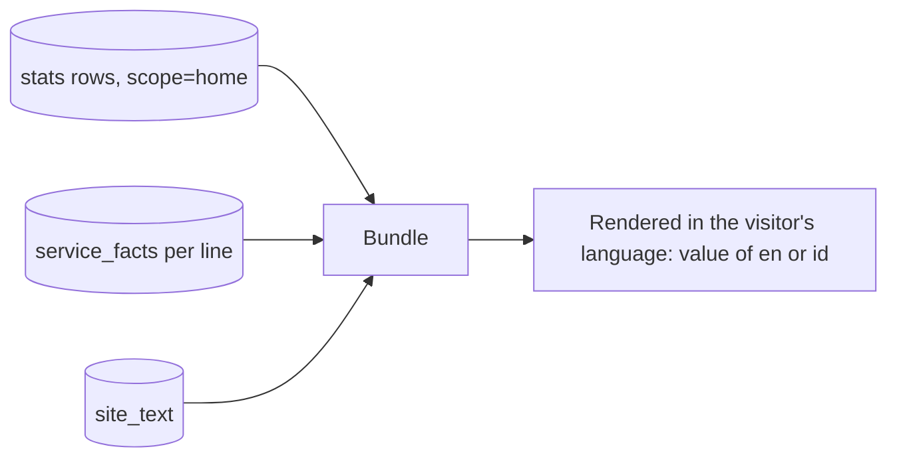

# 02a — The flows, drawn

The rules in `02` say what must be true; these diagrams show the shape.

## 1. The whole thing

What **flows** (solid) and what **constrains** (dotted).

## 2. Setup order, and what happens if a box is skipped

| Skipped | What you see |
|---|---|
| `migrate up` | the service refuses to start: "migration(s) pending" |
| `seed-assets` | the site renders with **no images** — rows exist, files do not (no broken images: rows without a file are left out) |
| first superadmin | `/admin` shows the setup screen; without `SFG_SETUP_TOKEN` it is closed and nobody can sign in |
| `notify.*` | submissions are stored, mail goes to the seeded address (itdept) |
| placeholders | the site shows dashed **Placeholder** tags; the CMS sidebar counts them |

## 3. A certificate's life

## 4. A quotation request

## 5. The refusal paths

## 6. Where a number on the site comes from

The "10+ years" on Home and on About are **different rows** (`stats.scope`),
so changing one does not change the other — as in the design, where the
labels differ.
