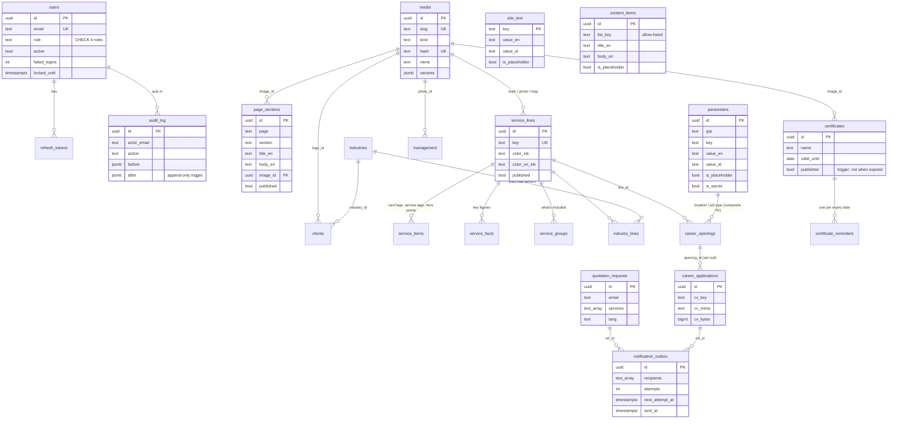

# 03 — Data model

The migrations in `db/migrations/` are the source of truth; this document
explains them. `0001_init` is the schema, `0002_seed_content` the seed
(generated from `scripts/seed/content.py`), `0003_more_site_text` catalogue
keys added later.

## ERD

## Tables

| Table | Holds | Notable constraints |
|---|---|---|
| `users` | CMS accounts | role CHECK (superadmin, editor, sales, hr); email lower-case unique; hash must be argon2id |
| `refresh_tokens` | hashed refresh tokens, rotation chain | token_hash unique; `replaced_by` for reuse detection |
| `revoked_jti` | logged-out access tokens until they would expire | |
| `audit_log` | every change | **append-only**: UPDATE/DELETE/TRUNCATE raise (BR-10.1) |
| `media` | library: seeded (slug) and uploaded | SVG only with a slug (BR-4.4); hash unique |
| `parameters` | configuration rows | unique (grp, key); grp/key format CHECKs; types enforced in `domain/params` |
| `site_text` | every interface string, EN + ID | key format CHECK |
| `page_sections` | titled blocks of each page | unique (page, section); page CHECK |
| `service_lines` | the five business lines, colours | key format; colours `#RRGGBB` CHECK; media FKs RESTRICT |
| `service_items` / `service_facts` / `service_groups` | per-line lists | kind CHECK; cascade with the line |
| `industries`, `industry_lines` | sectors; which lines serve each (one mapping, D12) | |
| `clients` | logos | logo FK RESTRICT; industry SET NULL |
| `certificates` | certificates | **trigger** refuses `published` with `valid_until < today (Jakarta)` (BR-3.2) |
| `certificate_reminders` | reminder ledger | PK (certificate, valid_until) — one mail per expiry (BR-3.4) |
| `career_openings` | openings | composite FKs to `parameters (grp, key)` for location and type |
| `testimonials`, `management` | people and quotes | placeholder flag |
| `content_items` | eight small lists (D11) | `list_key` CHECK allow-list; colour CHECK |
| `stats` | figure strips (home, about) | scope CHECK |
| `quotation_requests` | submissions | services ≥ 1; area range; lang CHECK |
| `career_applications` | submissions | cv_mime allow-list; bytes > 0 |
| `notification_outbox` | mail to send | recipients ≥ 1; partial index on unsent |

## Invariants the database enforces (not only the API)

1. Expired certificate cannot be published — trigger `certificates_expired_guard`.
2. Media in use cannot be deleted — every media FK is `ON DELETE RESTRICT`.
3. A location or job type in use cannot be deleted — composite FK to `parameters`.
4. Audit rows cannot be changed or removed — trigger `audit_log_no_update` / `_no_truncate`.
5. Roles, page names, list keys, colours, languages, mime types — CHECKs.

## Migration notes

- Each applied migration's SHA-256 is recorded; an edited file refuses to boot.
- `0002` is generated and deterministic (UUIDv7 ids from a fixed timestamp +
  natural-key hash). Never regenerate it once applied in production; add a
  new migration instead (as `0003` did).
- `migrate down` is refused when `SFG_ENV=production`.
