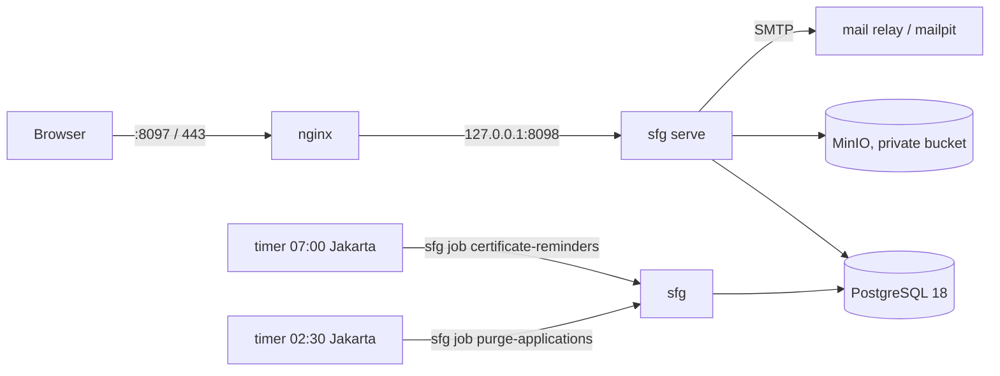

# 05 — Architecture and non-functional requirements

## Shape

One Go binary serves the API, the public site and the CMS (the built React
app is embedded with `go:embed`), runs migrations, seeds assets and runs the
jobs. nginx in front; PostgreSQL native; MinIO and mailpit in Docker.

Layering: `adapter → app → domain`, `platform` everywhere; the domain imports
nothing that does I/O. See `CLAUDE.md` §2.

## How a page is served

1. nginx proxies `GET /about` to Go.
2. Go reads the public **bundle** from an in-memory cache (rebuilt on any
   content write, and when the Jakarta date changes — BR-3.3).
3. Go writes `index.html` with the route's `<title>`, description,
   canonical, Open Graph, Twitter card and Organization JSON-LD, sets
   `<html lang>` (from `?lang=`), and embeds the bundle as
   `<script type="application/json">`. No second request is needed to render.
4. The browser renders the React app from the embedded bundle. Link-preview
   bots, which do not run JavaScript, read the head (99 §13).

## Performance

| Concern | Measure |
|---|---|
| First page JS | ~334 kB raw / ~99 kB gzip (React, router, site). Icons generated with only two weights (D30). |
| three.js | ~658 kB, **not** in the first load: imported after two animation frames + idle, only on Home |
| Hero ball | pixel ratio ≤ 1.75; loop stops off-screen (IntersectionObserver) and when the tab is hidden; with reduced motion no auto-spin, instant transitions, and the loop stops once idle |
| Images | WebP renditions with `srcset`; hash-named URLs cached 1 year `immutable`; logos 240/480 |
| HTML | `no-cache` (revalidates); hashed assets under `/assets/` immutable; nothing else immutable (impeccable §5) |
| Bundle | built once per content change; ETag for the API form |
| Fonts | Nohemi variable woff2, 40 kB, `font-display: swap` |
| DB | one read-only transaction per bundle rebuild; lists capped at 5,000 rows |

## Observability

- Structured JSON logs (slog) with `trace_id` = request id; access log has method, route, status, duration — no query strings, bodies or IPs.
- `/healthz` (process) and `/readyz` (database + object store).
- Mail delivery visible in CMS → Outgoing mail (attempts, last error).
- Audit history in the CMS.
- No `/metrics` endpoint in phase 1 (there is no monitoring stack to read it); listed in `08-roadmap.md`.

## Availability and data

- Single node. Restart on failure (systemd). The mail outbox makes SMTP outages harmless; jobs are idempotent and `Persistent=true` timers catch up.
- Backups: `pg_dump` + MinIO bucket mirror (`09-deployment.md`).

## Security

`12-security.md`. Headline: CSP without `unsafe-inline`; deny-by-default
roles; database-enforced invariants; append-only audit.
