# Website CMS — User guide

For the people who edit the Sunshine Facilities Group website, read its
inbox, and look after the people who use it. Every picture in this guide
is a screenshot of the real CMS, retaken whenever the CMS changes.

## Signing in

Open **https://sunshinefacility.sunshinefood.co.id/tytb** (the CMS address
moves to www.sunshinefacility.com/tytb once that domain is live). Enter your
email and password and press **Sign in**.

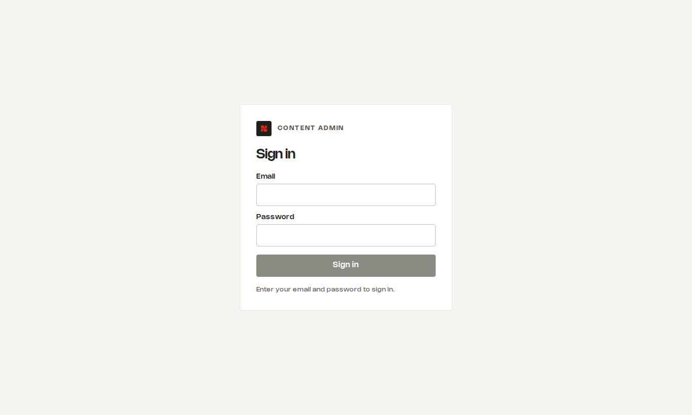

- The button stays grey until both boxes are filled; the line under it says what is missing.
- After **5 wrong passwords** the account locks for **15 minutes**. A superadmin can unlock it at once by setting a new password.
- **Forgotten your password?** There is no self-service reset. Ask a superadmin: *Users → your name → Reset password*.
- You stay signed in for up to 7 days on the same browser. **Sign out** (bottom left) when you use a shared computer.

After signing in you land on the first screen your role allows. The sidebar
on the left lists everything you can open; screens your role cannot use are
not shown.

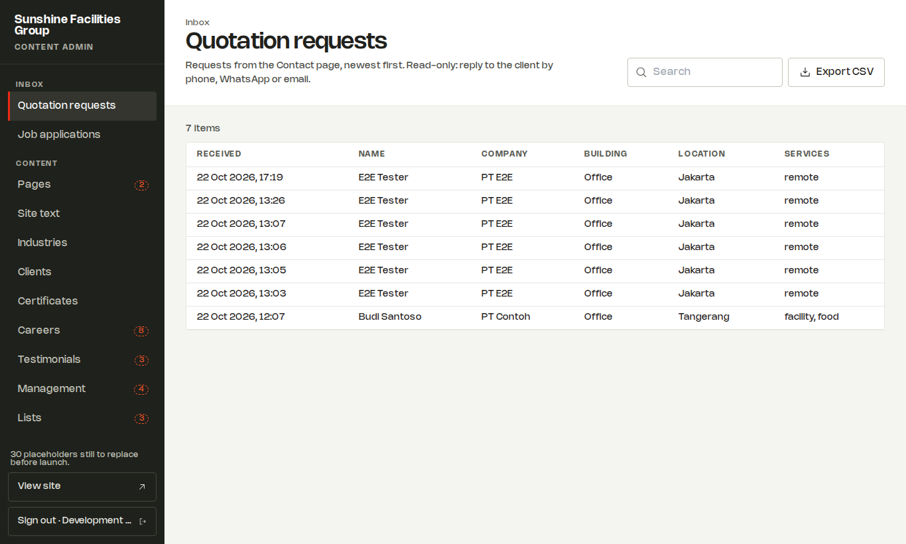

The red dashed numbers in the sidebar count **placeholders**: provisional
content still to be replaced (see *Placeholders*). The line above **View site**
gives the total. **View site** opens the public website in a new tab.

### Your role decides what you see

| You are | You can |
|---|---|
| **Editor** | change every text and image on the site; upload images; edit contact details, locations, job types, building types and brand colours |
| **Sales** | read quotation requests |
| **HR** | read job applications and open CVs |
| **Superadmin** | everything, plus users, notification recipients and other settings, audit history and outgoing mail |

## Lists: search, filter, export

Every screen is a list that works the same way.

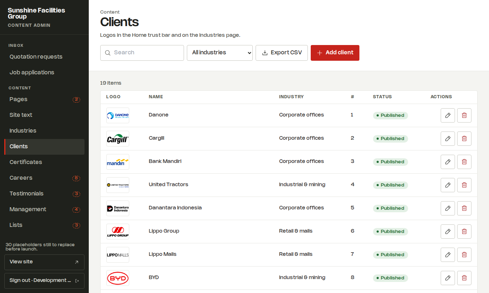

- **Search** box: type any words; the list narrows as you type. The **×** clears it.
- **Filters** beside it where useful (page, service line, list, group, industry…).
- **Export CSV** downloads exactly the rows you see, with the search and filters applied. Columns are separated by `|` (pipe), so Indonesian addresses with commas open correctly in Excel.
- **Add** creates a new row. It is greyed out where the rows are fixed by the site (for example Pages and Site text), and the screen says why.
- The **pencil** opens the editor on the right; the **bin** deletes after asking you to confirm.

A greyed-out button always tells you why. Here the search matches nothing,
so there is nothing to export:

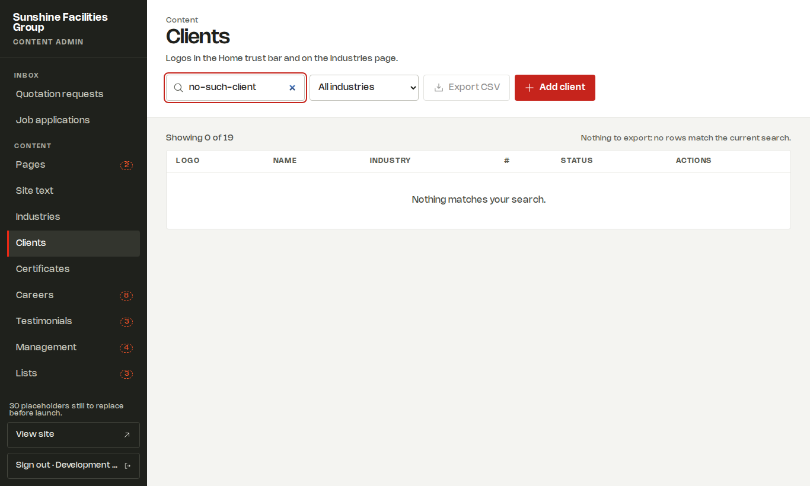

## Editing content

Press the **pencil** on a row. The editor opens on the right.

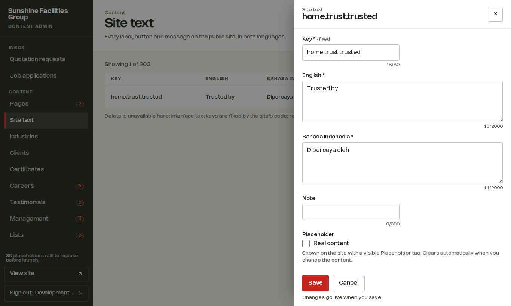

- Fields marked **\*** are required. **Save** stays grey with *"To save, fill in: …"* until they are filled.
- Every text has an **English** and a **Bahasa Indonesia** box. Fill both: visitors switch language at the top of the site.
- The small counter under a box shows how many characters are left.
- Images: **Choose from media** opens the media library with a search box.
- **Published**: ticked means on the site, unticked means *Draft (hidden from the site)*. **Placeholder**: ticked means shown with a *Placeholder* tag.
- **Changes are live on the site as soon as you press Save.** Cancel (or Esc) closes without saving.

### Where each thing on the site is edited

| On the site | In the CMS |
|---|---|
| Big headings and their paragraph on any page | **Pages** (filter by page) |
| Buttons, labels, small text, form messages, footer lines, SEO titles | **Site text** (search for the words you see) |
| The five service lines: names, descriptions, colours, photo | **Services** |
| Tags under each service, figures (5M+ meals…), "What's included" | **Service tags & points**, **Key figures**, **What's included** |
| Sectors on the Industries page and which services they use | **Industries** |
| Client logos | **Clients** |
| Certificates | **Certificates** |
| Job openings | **Careers** |
| Client quotes | **Testimonials** |
| Management team | **Management** |
| Why Sunshine points, journey timeline, mission, values, Lippo sectors, "one contract…", proof points, reasons to join | **Lists** (filter by list) |
| 10+ years, 18+ cities… | **Stats** (Home and About separately) |
| Phone, WhatsApp, email, address, hours, map pin, social links | **Parameters → Contact details / Social links** |
| Building types in the form, locations, job types | **Parameters** (option groups: you can add rows) |

**Pages** holds the headings and paragraphs of each page section:

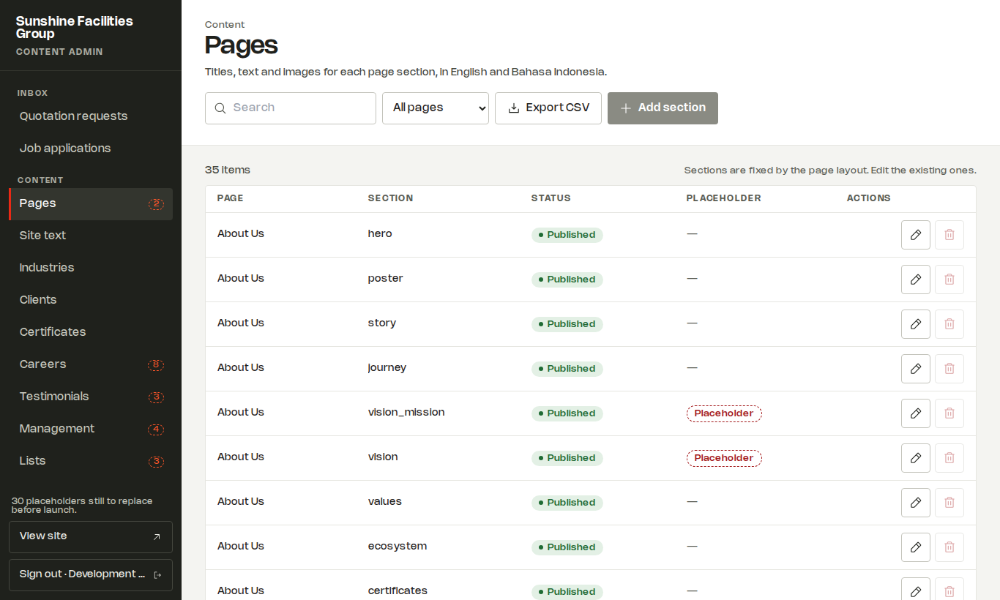

**Services** holds the five business lines, with their photo and colour:

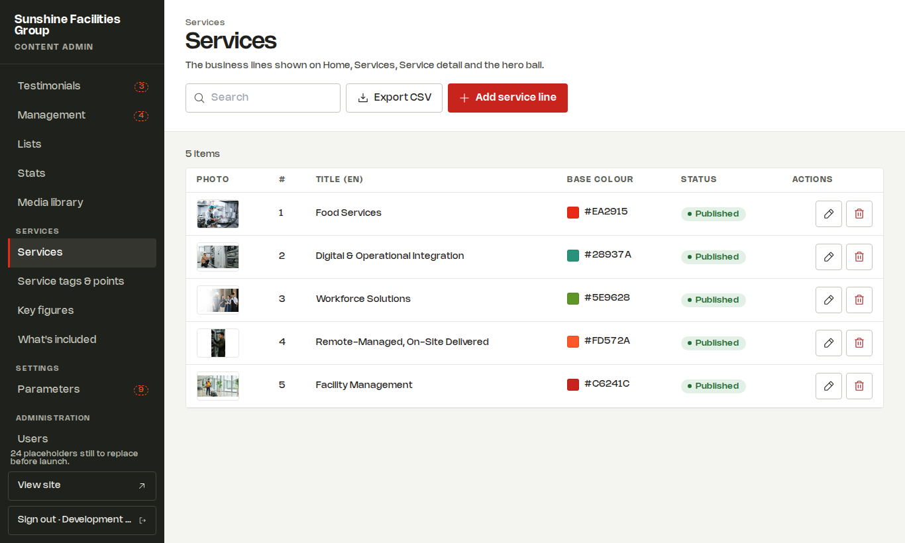

### Placeholders

Some content is provisional: contact details, social links, testimonials,
management, openings, vision and mission. It shows on the site with a
dashed **Placeholder** tag, and the sidebar counts how many remain.

- **Change the content and the tag disappears by itself.**
- To confirm content as real *without* changing it, open it and **untick** the Placeholder box: the label changes from *Still a placeholder* to *Real content*.
- Before launch the sidebar total should be **0**.

## Certificates

Certificates appear on Home, About and Food Services.

- A certificate past its **Valid until** date shows **Expired** and **cannot be published**: the switch is greyed out and says why.
- To renew: upload the new certificate in **Media library**, open the certificate, **Choose from media** to pick the new image, set the new date, then publish.
- A reminder email goes out some weeks before a certificate expires (60 days unless changed). The day after it expires it leaves the website by itself.

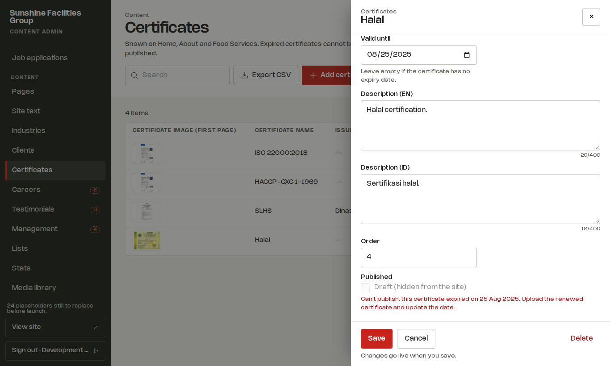

## Media library

Every image used on the site lives here.

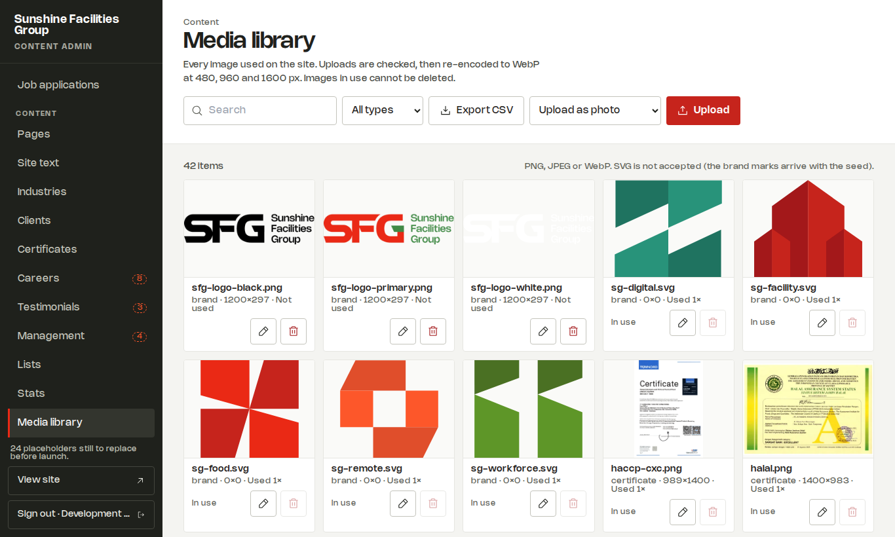

- Choose **Upload as** photo, logo, certificate or brand, then press **Upload**. PNG, JPEG or WebP; SVG is not accepted.
- The site checks the file and makes sharp, small versions automatically (480, 960 and 1600 px wide).
- Press the **pencil** to set the name and the **alt text** in both languages: what a blind visitor's screen reader says.
- An image **in use** cannot be deleted. Its bin is greyed out and says where it is used; replace it there first.

## Parameters (settings)

Values used by forms and filters, contact details, notification recipients
and thresholds. Filter by group to find a value quickly.

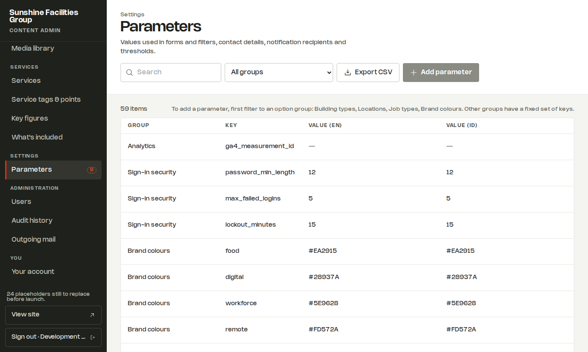

| Group | What | Who can change it |
|---|---|---|
| Contact details, Social links | phone, WhatsApp, email, address, hours, map pin, social URLs | editor |
| Building types, Locations, Job types | the choices in the forms and career filters (you can add rows) | editor |
| Brand colours | the five service-line colours | editor |
| Notifications | `quotation_to`, `career_to`, `certificate_to` (comma-separated emails), `from` | superadmin |
| Certificates | `reminder_days` | superadmin |
| Careers | `retention_months`, `cv_max_mb` | superadmin |
| Forms and spam protection | `min_fill_seconds`, `per_ip_per_hour`, `per_email_per_hour` | superadmin |
| Media uploads | `max_upload_mb`, `max_dimension_px` | superadmin |
| Sign-in security | `password_min_length`, `max_failed_logins`, `lockout_minutes` | superadmin |
| Analytics | `ga4_measurement_id` (empty means no analytics) | superadmin |
| Search and link previews | `og_image` (the name of a media item) | superadmin |

The office **phone** is hidden on the website while its value is empty (it is
empty now). Type a number into it to show it again in the footer, the Home
quotation band and the Contact page.

Values are checked: a retention of "twelve" or a recipient of "itdept" is
refused with the reason. **Add parameter** works only in the option groups
(building types, locations, job types, brand colours); the other groups
have a fixed set of keys.

## Inbox

### Quotation requests (Sales)

Requests sent from the Contact page, newest first. Each one is also emailed
to the people in *Parameters → Notifications → quotation_to*.

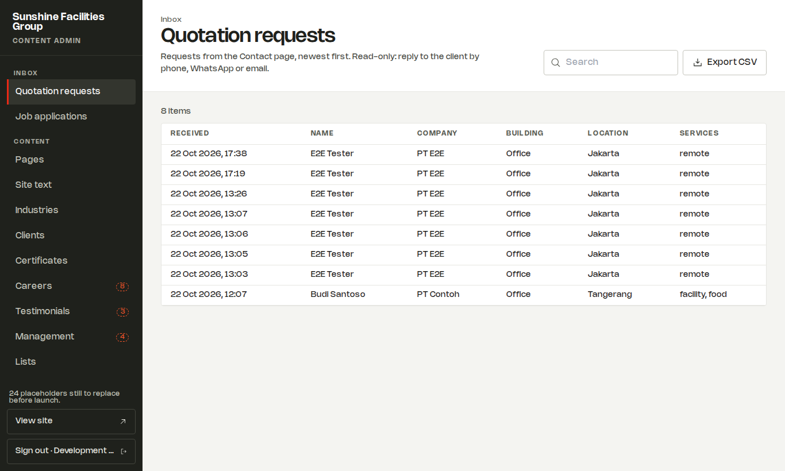

Click a row to see everything the visitor sent. Email and phone are links.

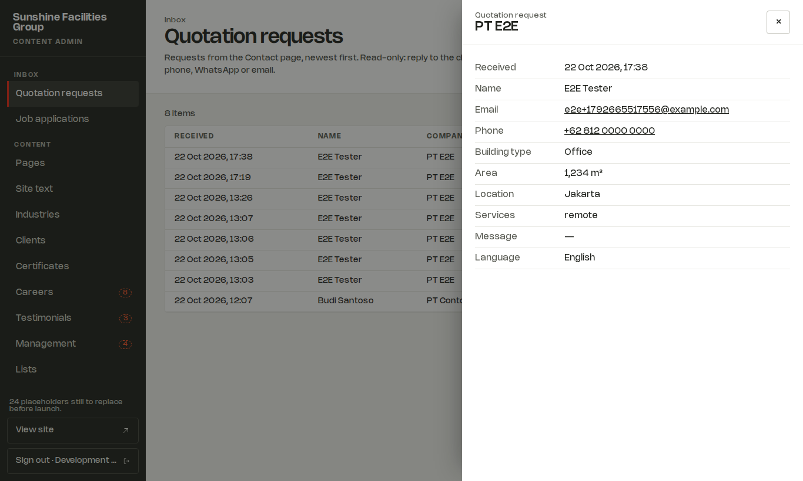

The inbox is **read-only**: there is no status or reply button. Reply to the
client by phone, WhatsApp or email.

### Job applications (HR)

Applications from the Careers page, newest first, emailed to *career_to*.

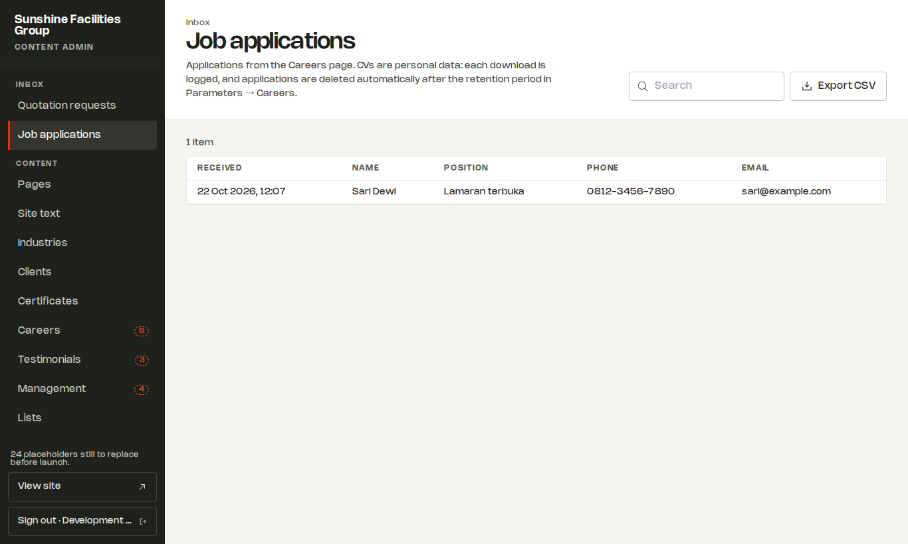

- **Open CV** gives a link that works for **five minutes**. Each opening is recorded in the audit history.
- The CV is never attached to the email: it is personal data and stays in the CMS.
- Applications are **deleted automatically** after the retention period (12 months unless changed in *Parameters → Careers*).

## Users (superadmin)

Who can sign in, and what each person can do.

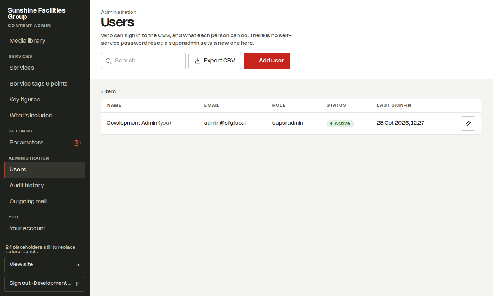

- **Add user**: name, email, role and a first password. Give the password to the person directly; they can change it under *Your account*.
- Open a user with the **pencil** to change the role, deactivate the account, or **Reset password**. A reset ends that person's sessions at once and unlocks a locked account.
- You cannot demote or deactivate yourself, and the last active superadmin cannot be demoted: make someone else superadmin first.

## Audit history (superadmin)

Every change, upload, deletion, CV download, password change or reset,
lockout and automatic deletion: who, when, from which address, and the
values before and after. Searchable and exportable. Nobody can edit or
delete it.

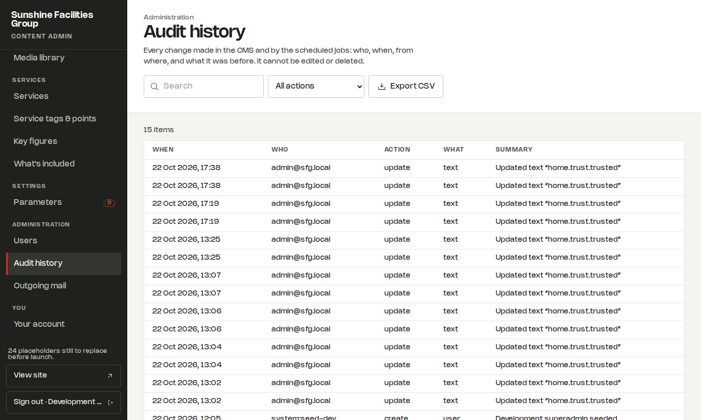

## Outgoing mail (superadmin)

Every notification email: **Queued**, **Sent**, or **Failed** with the last
error. Failed emails retry automatically (1 min, 5 min, 30 min, 2 h, 6 h,
then daily, up to 10 tries). The request itself is always safe in the inbox,
even when an email fails.

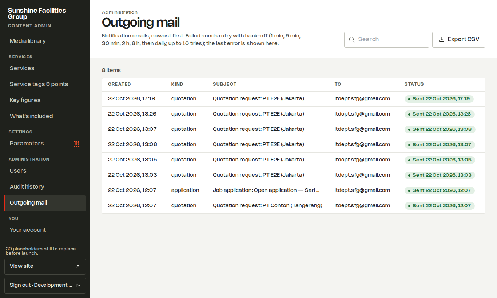

## Your account

Your name, email and role, and **Change password**. Enter your current
password and the new one twice. Use at least 12 characters.

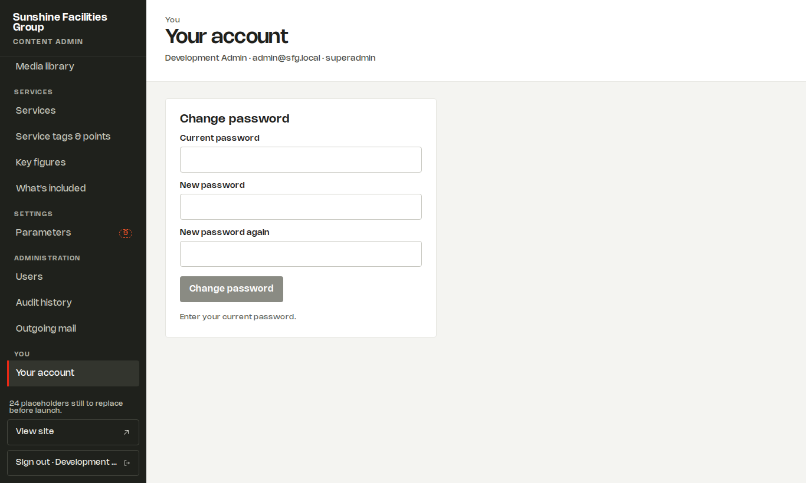

## Good habits

- Check the sidebar's **placeholder count**. It should reach 0 before launch.
- Superadmin, monthly: look at **Outgoing mail** for failures, review the **certificate dates**, and export the **audit history** if you keep an archive.
- Never share a password. Each person gets their own account so the audit history shows who did what.
- Something looks wrong on the site after a save? Open the same row, put the old text back, and press Save. The audit history shows exactly what the old text was.
